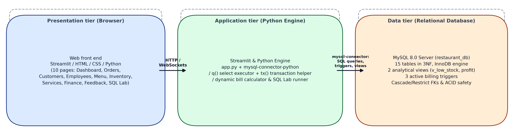
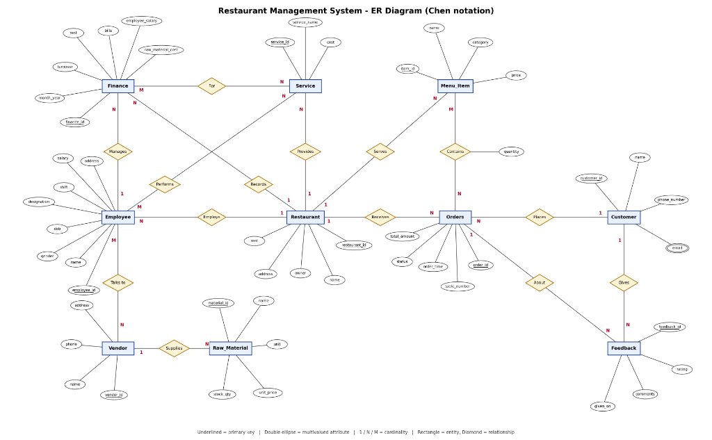

# 🍽️ Restaurant Management System (DBMS Mini-Project)

[](https://www.python.org/)
[](https://streamlit.io/)
[](https://www.mysql.com/)
[](#-database-architecture)
[](LICENSE)

An end-to-end relational database management system designed and built with **MySQL 8.0** and **Streamlit**. Designed for comprehensive restaurant operations—managing dining orders, billing, inventory, staff, customer feedback, and real-time financial reporting with complete ACID compliance and automated database triggers.

---

## 🏛️ System Architecture



The application follows an industry-standard **3-Tier Architecture**:
1. **Presentation Layer (Frontend):** Interactive multi-page Streamlit web application with modern CSS styling, real-time KPI metrics, responsive tables, and forms.
2. **Business Logic Layer (Backend):** Python backend with modular handlers, fallback rendering, input validation, and secure database connection pooling via `mysql-connector-python`.
3. **Data Layer (Storage & Integrity):** MySQL 8.0 relational database with 15 normalized tables (3NF), foreign keys, composite indexes, active PL/SQL triggers, and analytical views.

---

## 🗄️ Database Architecture & ER Diagram



### Key Database Features:
- **15 Relational Tables in 3NF:** Eliminates anomalies (insertion, deletion, update) and preserves data integrity.
- **Active PL/SQL Triggers:**
  - `trg_after_order_item_insert`: Automatically calculates subtotal, tax (5%), and grand total on adding an order item.
  - `trg_after_order_item_update`: Recalculates order financials when item quantities change.
  - `trg_after_order_item_delete`: Deducts item total when an item is removed from an order.
- **Analytical Views:**
  - `v_low_stock`: Real-time alerts for inventory ingredients falling below reorder threshold (≤ 15 units).
  - `v_monthly_profit`: Aggregated monthly turnover minus operating expenses to report net margins.

---

## 🌟 Modules & Features

| Module | Description |
| :--- | :--- |
| 📊 **Dashboard** | Real-time operational metrics: daily revenue, active orders, occupancy rate, low-stock alerts. |
| 🧾 **POS & Orders** | Create dining/takeaway orders, attach menu items, calculate taxes, and print bills. |
| 👥 **Customers** | Customer directory, visit history, loyalty tier, and lifetime spend tracking. |
| 👨‍🍳 **Staff & Roles** | Role-based employee management (Chefs, Waiters, Managers) with shifts and salary tracking. |
| 🍕 **Menu Management**| Categorized items (Starters, Mains, Desserts, Beverages) with price and availability toggles. |
| 📦 **Inventory & Vendors** | Raw material stock levels, unit metrics, reorder thresholds, and vendor purchase logging. |
| 🚚 **Services & Delivery**| Third-party delivery partner integration (Swiggy, Zomato, Direct) and delivery tracking. |
| 💰 **Finance & Expenses**| Comprehensive revenue vs. expense ledger with net profit calculations. |
| ⭐ **Feedback & Reviews**| Customer ratings, reviews, and sentiment analysis for food and service quality. |
| 🧪 **Live SQL Lab** | Interactive query runner for live demonstration of SELECT queries, JOINs, Views, and Triggers during viva/evaluations. |

---

## 📁 Repository Structure

```
├── app.py                                            # Main Streamlit Web Application (10 interactive modules)
├── restaurant_db.sql                                 # Complete MySQL schema, triggers, views & seed data
├── setup_database.py                                 # Automated database initialization & .env generator
├── run_app.bat                                       # Windows one-click launcher
├── requirements.txt                                  # Python dependencies
├── .env.example                                      # Environment template
│
├── ER_Diagram.png                                    # Chen-notation Entity-Relationship diagram
├── Restaurant_Architecture.png                       # 3-Tier Architecture schematic diagram
│
├── Restaurant_Management_System_Presentation.pptx   # Academic PowerPoint Presentation (12 Slides)
├── Mini_Project_Report_Restaurant_Management_System.docx # Complete academic Mini-Project Report
├── PROJECT_REPORT.html                               # Printable technical project report
├── PROJECT_REPORT.md                                 # Markdown technical documentation
└── README.md                                         # Project documentation
```

---

## 🚀 Getting Started

### Prerequisites
- **Python 3.10 - 3.13** installed
- **MySQL Server 8.0+** running locally (or via XAMPP / MySQL Workbench)
- **Git**

### 1. Clone Repository
```bash
git clone https://github.com/bhumikapursharthi/Restaurant-Management-System.git
cd Restaurant-Management-System
```

### 2. Install Dependencies
```bash
pip install -r requirements.txt
```

### 3. Initialize Database
Run the automated setup script:
```bash
python setup_database.py
```
*(Enter your MySQL root password when prompted. The script automatically executes `restaurant_db.sql` and generates your local `.env` configuration file).*

### 4. Launch the Application
Run via Streamlit:
```bash
streamlit run app.py
```
Or on Windows, simply double-click **`run_app.bat`**.

The application will launch in your browser at `http://localhost:8501`.

---

## 🛠️ Technology Stack

- **Frontend & UI:** Streamlit, HTML5, Custom CSS
- **Programming Language:** Python 3.13
- **Database:** MySQL 8.0
- **Database Driver:** `mysql-connector-python`
- **Environment Management:** `python-dotenv`

---

## 👩‍💻 Author

**Bhumika Pursharthi**
- GitHub: [@bhumikapursharthi](https://github.com/bhumikapursharthi)
- Academic Institution: JSPM's Rajarshi Shahu College of Engineering (RSCOE), Pune
